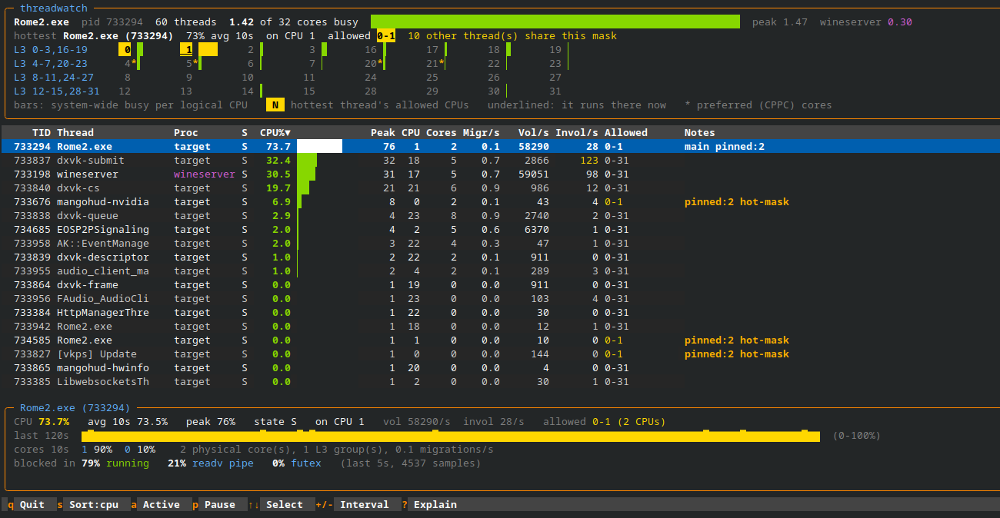

# threadwatch

**Per-thread CPU profiler for games on Linux (Proton / Wine and native): CPU time, context switches,
CPU affinity, SMT/L3 placement and what each hot thread is blocked in, without root or ptrace.**
For answering "why is this game CPU-bound?": is it one thread, what is that thread waiting on, are
busy threads fighting over the same core, how much time goes to wineserver. Record a run and
summarise it, or watch it live with `threadwatch top`.

Part of a small toolkit for investigating Linux gaming performance:
[gamerun](https://github.com/JasonBurnsInfosec/gamerun) (run and record) ·
[benchsum](https://github.com/JasonBurnsInfosec/benchsum) (frame-time statistics) · **threadwatch** (per-thread CPU and wait profiling)



*`threadwatch top` on Total War: ROME II under Proton: the main thread runs at 100% of one core while
only ~1.1 cores are busy overall, it is pinned to CPUs 0-1, and MangoHud's thread inherited that mask
(`hot-mask`), so it competes with the main thread for those two CPUs.*

## Why

An FPS number tells you *that* something is slow, not *why*. In CPU-bound games the answer is usually
in one or two threads: a main thread that is busy, or one that spends its frame waiting for other
threads, for the driver, or (under Wine) for wineserver. threadwatch samples every thread from `/proc`
and summarises it in terms you can act on, including per-frame costs when you give it the frame rate.

In the investigation it was built for (Total War: ROME II under Proton), it showed the game pinning its
main thread to two CPUs, MangoHud's sampler thread inheriting that pin, and the main thread losing time
to wineserver round trips, which led to the cause of an ntsync vs fsync gap.

## Features

- Per-thread CPU%, peak, run state, cores used, migrations, voluntary / involuntary context switches,
  allowed-CPU mask
- Per-core busy% with the CPU topology: SMT siblings, L3 (CCX) groups, firmware boost ranking (CPPC)
- **Extra processes** next to the game (`--also wineserver`)
- **Blocked-in profile** (`--syscalls HZ`): what the main thread and the busiest threads are doing when
  not running: futex, ntsync waits, wineserver replies, GPU driver ioctls, sleeps
- Summaries restricted to a benchmark window, with **per-frame** CPU time and context switches
- Heuristic hints: hot threads sharing a core, threads inheriting a pinned thread's mask, spin loops,
  wineserver waits
- **Live view** (`threadwatch top`): per-core bars grouped by L3 cache, a sortable thread table and an
  inspector for the selected thread, in the terminal
- Text, Markdown or JSON output; works for any process (emulators, encoders, servers), not only games
- Python 3.8+, standard library only, a single file; works on your own processes without root

## Install

```sh
git clone https://github.com/JasonBurnsInfosec/threadwatch ~/src/threadwatch
ln -s ~/src/threadwatch/threadwatch ~/.local/bin/threadwatch
```

## Quick start

```sh
# watch the running Steam game live (q quits, ? explains every column)
threadwatch top

# record it: start before or after the game; follows it until it exits
threadwatch record --syscalls 1000 -o rome2-run1
threadwatch summary rome2-run1 --fps 53.8            # --fps adds per-frame columns
threadwatch summary rome2-run1 --from 60 --to 172    # only part of the recording
threadwatch summary rome2-run1 --json > rome2.json   # the same as JSON, for scripts and dashboards

# any other process: pick it by name or pid (a non-Steam game, an emulator, an encoder, a build)
threadwatch top --name 'Game\.exe'
threadwatch record --name '^ffmpeg$' -d 60 -o ffmpeg-sample && threadwatch summary ffmpeg-sample
```

[gamerun](https://github.com/JasonBurnsInfosec/gamerun) runs threadwatch automatically for every
launch and limits the summary to the benchmark window.

## Live view

```sh
threadwatch top                          # the running Steam game (waits for one to start)
threadwatch top --syscalls 1000          # also show what the selected thread is blocked in
threadwatch top --pid 12345              # any process; or --name REGEX
```

A terminal dashboard of the same data `record` collects (screenshot at the top), refreshed every second
(`-i` to change):

- **Header**: the game's name and Steam app ID in the title, the target's threads and cores busy (1.00 = one full core) with a history sparkline (scaled from 0 to the peak, rounded up to whole cores), the
  hottest thread and its allowed-CPU mask, and every logical CPU grouped by L3 cache with system-wide
  busy%. CPUs the hottest thread may run on are highlighted, the one it is on now is underlined, and
  `*` marks the firmware's preferred (CPPC) cores.
- **Thread table**: CPU% now and 10 s peak, current CPU, cores used, migrations, voluntary and
  involuntary context switches, allowed mask, and notes (`main`, `pinned:N`, `hot-mask` for threads
  sharing the hottest thread's mask, `spin?`). Idle threads are hidden until you press `a`.
- **Inspector** for the selected thread: 2-minute CPU sparkline, which cores it ran on, and with
  `--syscalls` what it is blocked in over the last 5 s (futex, ntsync waits, wineserver pipe reads...).

Keys: `↑↓`/`j k` select, `s` sort, `a` all/active threads, `p` pause, `+ -` interval, `?` explains every
column, `q` quits. It waits for the game (or the `--name` match) and picks up the next one when it exits.
If the game starts from a launcher, it moves to the game once that is clearly busier.
It records nothing; use `record` when you need numbers you can quote. Standard library `curses`, no extra
dependencies.

## Choosing the process

By default `top` and `record` find the running **Steam game** on their own. Steam puts `SteamAppId` in the
environment of everything it starts for a game; threadwatch takes those processes, drops Wine/Proton
helpers (wineserver, `services.exe`, the Proton script, pressure-vessel, the overlay...) and picks the
busiest `.exe`, or for a native game the busiest process. The game's name comes from Steam's app manifest,
and the game's own wineserver is shown next to it (not every wineserver on the system). Nothing to
configure, and it works whether you start threadwatch before or after the game.

Pick a process yourself when that isn't what you want: `--appid N` for one of several running games,
`--pid` or `--name` for anything else (non-Steam games, Lutris/Heroic, emulators, any program), `--root`
for descendants of a launcher. Reading another process's environment needs the same user, as with the
rest of `/proc`.

## Recording

```
threadwatch record [--appid N | --pid PID | --name REGEX | --root PID [--name REGEX]] [--also REGEX]...
                   [--syscalls HZ] [-o DIR] [-i SECS] [-d SECS] [--wait SECS]
```

| option | |
|---|---|
| (none) | the running Steam game; waits for one to start (see above) |
| `--appid N` | the Steam game with app ID N, when several are running |
| `--pid PID` | follow this process |
| `--name REGEX` | wait for a process whose name or argv0 basename matches (case-insensitive). Wine puts the `.exe` name in argv0, so `'Game\.exe'` works |
| `--root PID` | only consider descendants of PID (e.g. a launch wrapper). Without `--name`, picks the busiest `.exe` (≥0.5 core), or after 20 s the busiest process (≥0.2 core) |
| `--also REGEX` | also record every process matching REGEX, system-wide (repeatable). Without it, a Steam game's own wineserver is recorded automatically |
| `--syscalls HZ` | sample what threads are blocked in, HZ times per second (500–1000 is plenty) |
| `-o DIR` | output directory (default `threadwatch-<timestamp>`) |
| `-i SECS` | sampling interval, default 0.25 |
| `-d SECS` | stop after SECS (default: when the target exits) |
| `--wait SECS` | give up if no target appears within SECS |

Output files:

| file | contents |
|---|---|
| `threads.csv` | t, tid, thread name, state, last CPU, CPU%, voluntary and involuntary switches per second, allowed-CPU list, process (`target` or the `--also` name), pid |
| `cores.csv` | busy% per logical CPU (system-wide) |
| `syscalls.csv` | with `--syscalls`: per second and thread, how many samples were running or in each syscall |
| `meta.json` | target, Steam app ID and game name, settings, extra processes seen, CPU topology |

### How syscall sampling works

`/proc/<pid>/task/<tid>/syscall` shows the system call a sleeping thread is currently in, with its
arguments; for a running thread it shows `running`. Sampling it many times per second gives a profile of
where the thread spends wall time. It is statistical (not a trace), needs no ptrace and no root, and
costs part of one core while it runs, so keep it off in runs whose FPS you compare.

Sampled threads: the target's main thread, its two busiest threads (re-chosen every ~2 s) and the main
thread of each `--also` process. Wine/Proton details handled for you:

- 32-bit Windows games run as 32-bit Linux processes and use the **i386** syscall numbers; threadwatch
  picks the table from the process's ELF class.
- **ntsync** ioctls are decoded (`ioctl ntsync WAIT_ANY`, `EVENT_SET`, …).
- File descriptors of read/write calls are resolved. In a Wine process, `readv pipe` is usually the
  thread waiting for a **wineserver** reply; `ioctl /dev/dri/…` or `/dev/nvidiactl` is the GPU driver.

## Summary options

```
threadwatch summary DIR [--window FILE | --from S --to S | --no-window] [--fps N] [--top N] [--markdown | --json]
```

| option | |
|---|---|
| `--window FILE` | restrict to a `window.json` (benchsum `--write-window` / gamerun). Default: `DIR/../window.json` if it exists |
| `--no-window` | summarize the whole recording |
| `--from S`, `--to S` | seconds since the recording started |
| `--fps N` | frame rate for the per-frame columns (default: the window's avg FPS) |
| `--top N` | threads to list (default 15) |
| `--markdown` | tables for GitHub |
| `--json` | everything as JSON: threads, `--also` processes, blocked-in profiles, hot-thread placement, masks, per-core busy, hints |

## Reading the summary

```
**Rome2.exe** (pid 552637): window auto:112:250 from window.json, 112 s, ... avg 1.68 cores busy of 32, per-frame figures at 89.86 FPS

   tid  thread       avg CPU%  peak%  running%  cores used  migr/s  vol cs/s  invol cs/s  allowed  CPU ms/frame  vol cs/frame
552637  Rome2.exe        83.9     95        84           2    1.43     18900          51      0-1          9.33           210
552703  (unnamed)        20.5     40        22           2    1.78      6977          28      2-3          2.28            78

**wineserver** (--also): 1 threads, avg 0.15 cores busy, 1.62 ms CPU per frame

Where threads are blocked (sampled at 500.0 Hz, % of wall time):
- target main thread (52513 samples): 86.6% running, 8.0% readv pipe, 2.9% futex, 2.5% ioctl ntsync WAIT_ANY
- target hot thread 552703 (46785 samples): 70.8% ioctl ntsync WAIT_ANY, 22.4% running, 5.3% futex

Hints (heuristics, verify before concluding):
- Hottest thread is restricted to CPUs 0-1, and 9 other thread(s) share that mask (1 using >=1% CPU: mangohud-nvidia). ...
- Main thread spends 8% of wall time waiting on a pipe/socket read; in Wine that is usually a wineserver reply ...
```

| column | meaning |
|---|---|
| avg CPU% | CPU time as % of one core (100 = one full core) |
| running% | share of samples in which the thread was runnable or running |
| cores used | distinct logical CPUs it ran on while busy |
| migr/s | moves between CPUs per second |
| vol cs/s | voluntary context switches per second: the thread blocked (waited) that often |
| invol cs/s | involuntary switches: the scheduler preempted it (CPU contention) |
| allowed | its CPU affinity mask (most common value in the window) |
| CPU ms/frame, vol cs/frame | per-frame cost, with `--fps` or the window's avg FPS |

Patterns to look for:

- **One thread near 100% CPU** while most cores idle: bound by that thread. Look at what it does.
- **A main thread well under 100% but slow frames**: it is waiting. The blocked-in profile tells you on
  what (other threads, wineserver, the driver).
- **High voluntary switch rates** (tens of thousands per second): fine-grained synchronisation; under
  Wine, check sync mode (ntsync / fsync) and wineserver CPU.
- **Hot threads on the same logical CPU or SMT siblings**: placement or affinity problem.
- **Many threads sharing the hottest thread's restricted mask**: threads created by a pinned thread
  inherit its affinity (overlays, driver threads) and compete with it.

## Limitations

- Sampling at 0.25 s (CPU) and up to ~1–2 kHz (syscalls): very short events are averaged out.
- `top` refreshes every 1 s by default and keeps only the last 2 minutes of each thread; it saves
  nothing. Its `--syscalls` sampling costs a little CPU of its own, like `record`'s.
- `top` needs a terminal of at least 60x16; 100+ columns shows the full per-core bars.
- Thread names come from the kernel's `comm` (Wine fills it from `SetThreadDescription`); unnamed
  threads show as `(unnamed)`.
- `--also` matches system-wide: with several Wine prefixes running, it records every wineserver (the
  default Steam mode picks only the game's own).
- The default mode finds games that Steam launched (it relies on `SteamAppId`); for games started any
  other way use `--pid` or `--name`. A launcher that stays busier than the game keeps being shown; pick
  the game with `--name` then.
- Linux only (`/proc`, `/sys` topology).

## Related

- [gamerun](https://github.com/JasonBurnsInfosec/gamerun): runs threadwatch automatically with each game launch
- [benchsum](https://github.com/JasonBurnsInfosec/benchsum): frame-time statistics; writes the window threadwatch summarises

## License

MIT, see [LICENSE](LICENSE).
